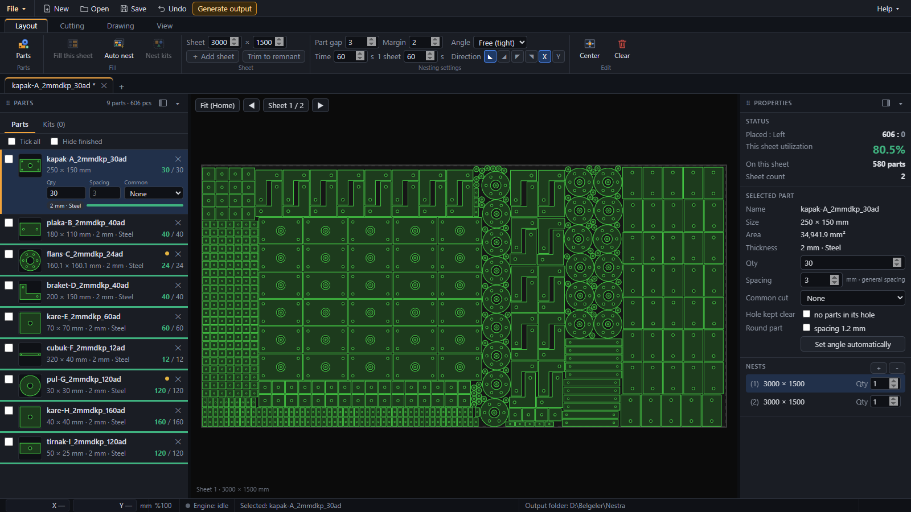
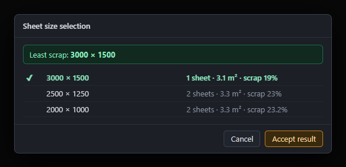
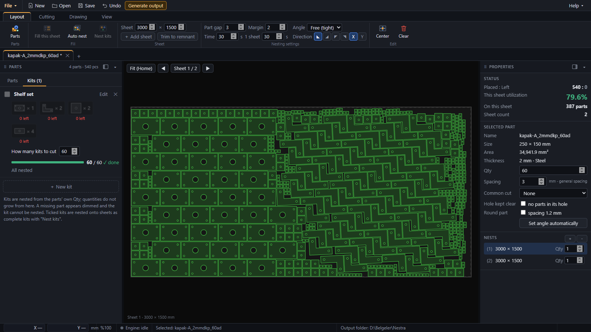
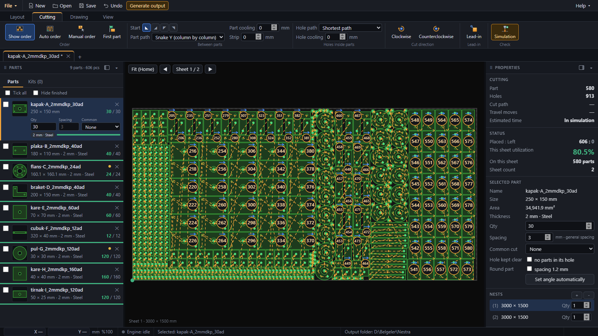
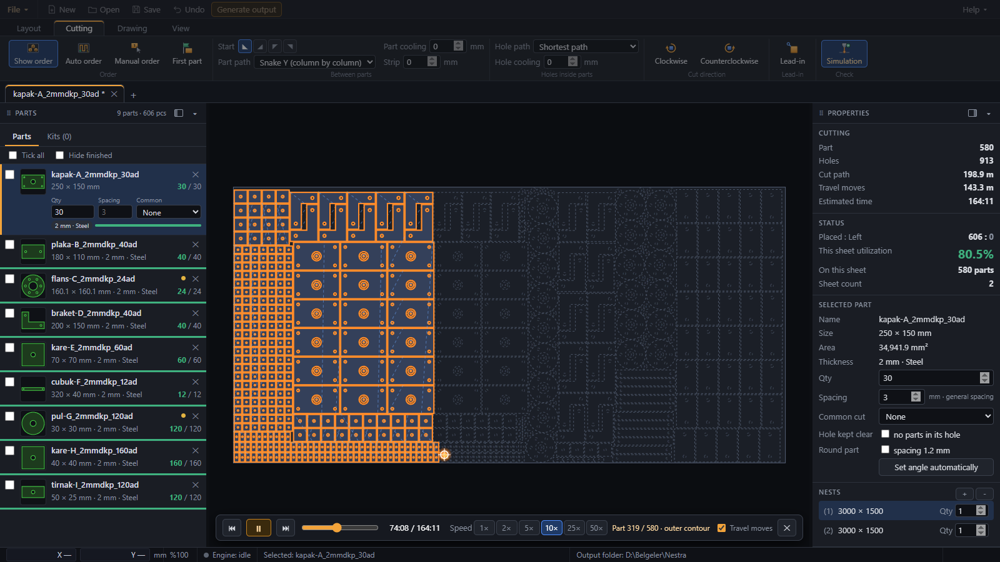
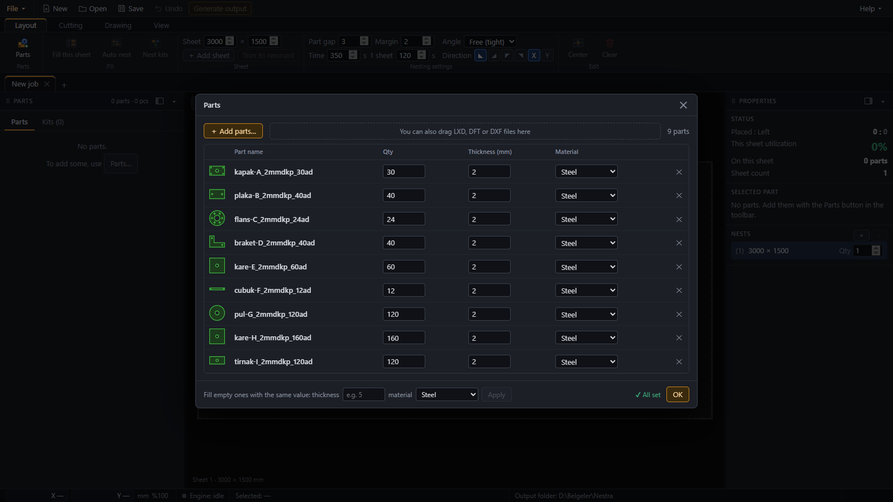
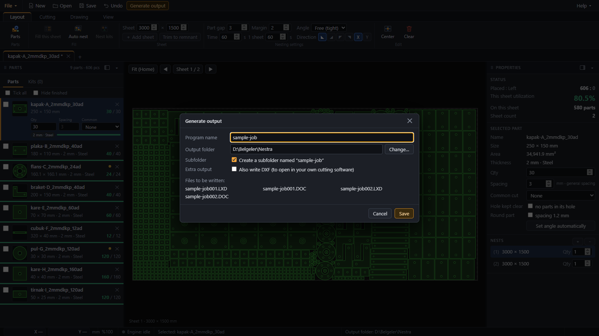

<a href="README.md"> <b>English</b></a> &nbsp;·&nbsp; <a href="README.tr.md"> Türkçe</a>

# Nestra: nesting software for laser, plasma and CNC sheet cutting

Nestra is a Windows nesting program for sheet metal. It packs your parts onto the sheet so that as little material as possible ends up as scrap, and it writes the cutting files for your machine. It runs offline on the PC you install it on: no account, no cloud, no internet needed to work.

It was built inside a working laser cutting shop and tuned on real production jobs, from a handful of large parts up to plates with thousands of small ones.

[**Download the latest version**](https://nestracam.com/en/download/) · Windows 10 / 11, 64-bit · 14-day free trial

New versions, help and licenses: **[nestracam.com](https://nestracam.com/en/)**. This page is no longer updated.

*Sample job: nine part types, 606 parts, 3000 x 1500 sheets. In 60 seconds the engine packed 580 parts onto the first sheet at 80.5% utilization; the rest went to a second sheet. Small parts filled the gaps between large ones and the holes inside them.*

## Who it is for

- Laser, plasma and waterjet cutting shops that nest sheet metal every day
- CAD / CAM operators who prepare cutting programs and want less scrap per job
- Manufacturers who cut their own parts and need a simple, offline nesting tool

## The nesting engine

This is the part we put the most work into.

**True-shape nesting.** Parts are nested by their real outline, not by a bounding rectangle. Parts are rotated freely to find the tightest fit.

**Thousands of trials, the best one stays.** The engine spreads over all CPU cores and tries a large number of different layouts at the same time. The screen always shows the best layout so far, so the result never gets worse. You set how long it runs; press Stop at any moment and you keep what is on the screen.

**Compaction.** As parts are added, the whole layout is pushed together again and again. The used length of the sheet gets shorter and the leftover piece gets bigger.

**Small parts fill the holes.** Gaps between large parts and the holes inside them are filled with small parts (part-in-part nesting). If a hole must stay empty, you mark it on that part.

**Tidy rows for repeated parts.** Parts with large quantities are laid out in rows, blocks, honeycomb patterns or interlocking pairs, so the operator can see at a glance what is where.

**Common-line cutting.** Parts you choose can share an edge and be cut with a single line.

**Your manual work is kept.** Parts you place by hand stay where they are; the engine nests the rest around them. "Fill this sheet" only fills the empty space of the sheet on screen.

**No overlaps.** Every result is checked before it is shown. A layout with overlapping parts or a broken gap is never offered.

**Fewer sheets.** On multi-sheet jobs the engine tries to empty the last sheet, so the job needs one sheet less wherever possible.

## Choose the sheet size with the least scrap

Tick the sheet sizes you have in stock and press Auto nest. Nestra tries each size, compacts the winner and then moves every sheet to the smallest size it fits on. The table shows all sizes side by side and suggests the one that leaves the least scrap. The empty end of the last sheet is not counted as scrap: it is cut off at the remnant line and goes back to stock.

Every sheet in a job can have its own size, and each one gets its own output files.

## Kit nesting

When parts are cut as sets (for example 1 cover + 2 brackets + 2 square plates + 4 tabs), define a kit and say how many you need. Nestra nests only complete kits: no half sets, no extra parts left over. When a sheet is full, the same sheet is repeated for the remaining kits.

## Remnants and leftover sheets

- **Remnant line:** a cut line is added after the last part so the unused end of the sheet comes off as a clean remnant. It can be moved, deleted or turned into a stepped line that follows the parts.
- **Trim to remnant:** shrink the sheet to the used length with one click, or wrap it around the parts.
- **Leftover sheets as plates:** with "Add remnant sheet", load an irregular leftover sheet from a DXF or DFT file and nest new parts onto it.
- **Drawing on the sheet:** add your own cut, marking or keep-out lines directly on the sheet.

## Cutting order and simulation

Nestra sets the cutting order for you: the sheet is cut in strips from the start corner, holes are cut before the outer contour of each part. Lead-ins are placed automatically on a safe corner. Click any contour to move a lead-in or change its length; one change applies to every copy of that part on the sheet.

The simulation plays the cut on screen so you can check the order before the sheet goes on the machine.

## Parts in, cutting files out

**Input:** LXD, DFT and DXF part files. Drop them into the Parts window; quantity and thickness are read from the file name when they are written there, and you fill in the rest.

**Output:** for every layout an LXD file and a DOC sheet report, and a DXF if you want one. The report shows the sheet picture, material, utilization and an estimated cutting time. Identical sheets are written once with their count. Output can go straight to the folder your cutting machine reads from.

## Also included

- English and Turkish interface. It follows the Windows language and can be changed in Settings.
- Several jobs open at once in tabs.
- `.nestra` job files, plus automatic recovery copies if the program is closed without saving.
- All fixed settings in one Settings window, with export / import to move them to another PC.
- You choose how much of the CPU the engine may use.
- "Create support package" collects the job, logs and PC info into a zip. You see what goes in, and it is never sent anywhere by itself.

## Download and install

1. Download `Nestra-Kurulum-<version>.exe` from [nestracam.com/en/download](https://nestracam.com/en/download/) (about 100 MB).
2. Run it. The program installs into your user account.

**The installer is not digitally signed yet.** Windows and some browsers warn about unsigned programs from new publishers. The file is safe; this is what you may see:

- **While downloading:** the browser may say the file "isn't commonly downloaded" or "could harm your device". Open the download list, click the file's menu and choose **Keep** (the wording differs between Edge and Chrome).
- **When you start the installer:** a blue window says "Windows protected your PC". Click **More info**, then **Run anyway**.
- **Antivirus:** some antivirus programs block or quarantine unsigned files they have not seen before. If the installer disappears or will not start, restore it from quarantine or add an exception.
- **Updates:** if an update gets stuck for the same reason, Nestra shows an error after a minute with a **Download manually** button; install the new version over the old one.

During setup you are asked whether LXD, DFT and DXF files should open in Nestra on double-click. If you leave it unticked, they keep opening in the program they open in now.

## Trial and license

Press "Try for 14 days" on first start: the program works fully without a key for 14 days. When the trial ends it locks and asks for a key. A window left open locks within a few minutes; your work is not lost and you continue where you left off after entering the key.

To get a key, click the "Trial: ..." text in the status bar, copy the machine code and send it with your company name to darkhesaplar@gmail.com. The machine code is not secret, and the key only works on that computer. The license works without internet: the key is entered by hand.

## Updates

When the PC is online, Nestra checks nestracam.com for a new version at start-up. If there is one, an "Update" button appears in the status bar. It downloads the update, checks its integrity and our signature, closes the program, installs and reopens it. If you have unsaved work, it asks you to save it first. On offline PCs nothing happens; copy the new installer on a USB stick and install it over the old one. Your settings and jobs stay.

## Known limits

- DXF: lines, arcs, circles and LWPOLYLINE are read. SPLINE, ELLIPSE, blocks (INSERT) and old-style POLYLINE are not read yet and are skipped, so a part may come in incomplete. Check the part shape in the part list before nesting.
- Check on your first job that your cutting software opens our LXD and DOC files. Do not go to production before testing with your own files.
- Windows 7 and 8 are not supported.

## Questions and bug reports

Write to darkhesaplar@gmail.com for questions, bug reports and license requests. When reporting a bug, please attach the zip from Help → "Create support package". The About window shows the program version, engine version and license state.
